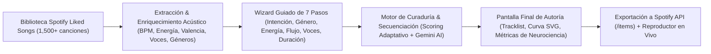
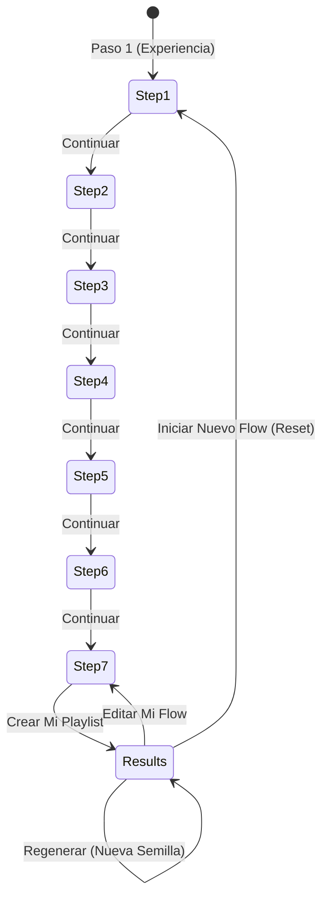
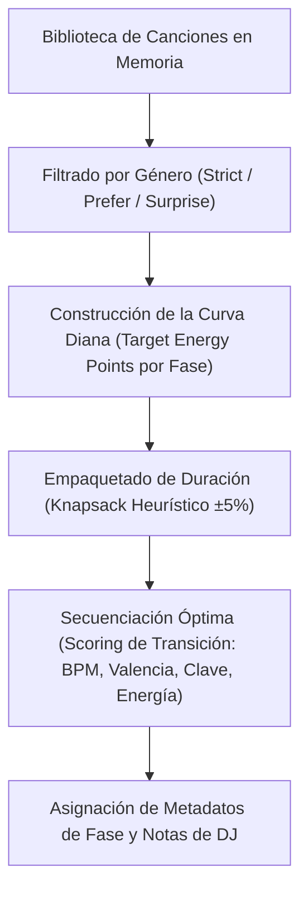

# Especificación Integral de Arquitectura, UX/UI y Funcionamiento de WaveFlow

> **Versión del Sistema:** 2.4.0  
> **Propósito del Documento:** Guía exhaustiva de ingeniería de producto, arquitectura de software, experiencia de usuario (UI/UX) y áreas estratégicas de mejora para **WaveFlow DJ Studio**.  
> **Sitio Web en Producción:** [https://waveflowmix.netlify.app/](https://waveflowmix.netlify.app/)

---

## 1. Visión General y Concepto de Producto

**WaveFlow** es una plataforma web inteligente de curaduría y síntesis musical basada en principios de **neurociencia cognitiva y técnicas profesionales de DJ de club**.

A diferencia de los generadores tradicionales de listas de reproducción que se limitan a pedir un número arbitrario de canciones (ej. *"dame 20 canciones de Rock"*), WaveFlow transforma la creación en un **viaje intencional calibrado por duración y estado mental**:
* **Enfoque en la intención cognitiva:** El usuario define qué estado emocional o productivo busca (ej. *Deep Focus*, *Party / Festival Explosive*, *Night Drive*, etc.).
* **Authorship & Empoderamiento:** El usuario es el autor de su set (*"You made this flow. Your taste. Your choices. Your soundtrack"*). WaveFlow actúa como el director musical cognitivo y asistente de DJ.
* **Calibración estricta de tiempo:** En lugar de conteos estáticos de pistas, el motor calcula el empaquetado de canciones para cumplir con la duración deseada dentro de una tolerancia de $\pm 5\%$.



---

## 2. Stack Tecnológico y Arquitectura de Software

| Capa | Tecnología | Función Principal |
| :--- | :--- | :--- |
| **Framework UI** | React 18 + TypeScript | Renderizado reactivo, interfaces modulares y tipado estricto. |
| **Estilos & Diseño** | Tailwind CSS + Lucide Icons | Estética oscura profesional inspirada en Spotify y consolas de DJ. |
| **Gestión de Estado** | Zustand (`useWaveFlowStore`) | Estado global reactivo, persistencia en `localStorage`, control del wizard y reproducción. |
| **Empaquetador & Dev** | Vite 6 | Compilación rápida, Hot Module Replacement (HMR) y optimización para producción. |
| **Autenticación** | Spotify OAuth 2.0 PKCE | Conexión segura sin exponer secretos de cliente; permisos para lectura de librerías y creación de playlists públicas/privadas. |
| **API Externa** | Spotify Web API (`/v1`) | Ingesta de canciones guardadas (`/me/tracks`) y creación/adición de elementos (`/playlists/{id}/items`). |
| **Inteligencia Artificial** | Google Gemini API (1.5 Flash) | Calificación contextual de energía acústica, tono emocional y afinamiento de transiciones. |
| **Motor de Audio** | HTML5 Audio + iTunes/Apple Music Fallback Resolver | Reproducción instantánea de 30 segundos con voces reales de estudio cuando Spotify no ofrece preview. |
| **Efectos Visuales** | Canvas Confetti | Celebración visual de autoría cuando el usuario confirma satisfacción. |
| **Despliegue** | Netlify | CDN global, compilación continua (`git push origin main`) y soporte de rutas SPA. |

---

## 3. Flujo Detallado del Usuario: El Wizard Paso a Paso

El núcleo de WaveFlow es un **Wizard paso a paso real**, donde **únicamente se muestra un paso a la vez**, eliminando scrolls excesivos y pantallas congestionadas. En la parte superior siempre se exhibe un indicador dinámico de avance (`Paso X de 7`) con botones directos para saltar entre pasos completados.



---

### Paso 1: Choose Your Experience (Experiencia e Intención Cognitiva)
* **Objetivo:** Definir el destino emocional y la estructura del set.
* **Componentes UI:**
  * **Pestañas de Filtrado por Categoría:**
    * *All Experiences* (Todas)
    * *Focus & Creativity* (Enfoque, Estudio, Flujo Creativo)
    * *Relaxation & Emotion* (Desconexión, Cambio de Ánimo)
    * *Energy & Movement* (Entrenamiento, Festival, Despertar)
    * *Journey & Exploration* (Manejo Nocturno, Roadtrip, Descubrimiento)
  * **Rejilla de 12 Tarjetas de Intención:**
    1. **Deep Focus:** Ritmo ultradiano (75–90 min), energía estable ($40\text{--}65\%$), transiciones imperceptibles ($\le 3$ BPM) y caída final de descompresión.
    2. **Reading & Study:** Texturas acústicas/lo-fi, mínima intrusión vocal, cadencia sostenida.
    3. **Creative Flow:** Micro-picos de inspiración y dinamismo rítmico moderado.
    4. **Relax & Unwind:** Descenso gradual de pulsaciones, valencia cálida, paisajes sonoros relajantes.
    5. **Mood Shift:** Trayectoria emocional guiada (desde el estado actual hasta el deseado).
    6. **Night Drive:** Onda multicresta con "valles de descanso" cada 45 min para evitar fatiga auditiva.
    7. **Party / Festival Explosive:** Calentamiento rápido, meseta máxima ($85\text{--}100\%$ de energía) y cierre en 2 canciones.
    8. **Workout:** Aceleración rítmica, alta cadencia motora e intervalos de potencia.
    9. **Morning Boost:** Ascenso progresivo desde energía moderada hasta un despertar enérgico.
    10. **Roadtrip:** Narrativa sonora continua y balanceada para largas distancias.
    11. **Genre & Cadence Lock:** Bloqueo estricto de tempo y acento rítmico (ej. Ska, Dub, House).
    12. **Musical Discovery:** Mezcla balanceada entre canciones predilectas y tesoros poco reproducidos.
  * **Interacción:** Cada tarjeta muestra título, badge, lema inspirador, objetivo musical, duración recomendada y número de fases. Al hacer clic se actualiza automáticamente la duración por defecto y se resalta la tarjeta en verde Spotify.

---

### Paso 2: Choose Your Sound (Géneros y Paleta Sonora)
* **Objetivo:** Definir cómo se seleccionan los estilos musicales dentro de la biblioteca del usuario.
* **3 Modos de Selección:**
  * **A. Surprise Me:** WaveFlow selecciona libremente entre todos los estilos presentes en la biblioteca.
  * **B. Prefer These Genres (Recomendado):** Otorga un fuerte bono de puntuación ($+40$ puntos) a los géneros seleccionados, pero permite que temas compatibles de otros géneros enlacen las transiciones de forma orgánica.
  * **C. Only These Genres (Filtro Estricto):** Filtro rígido. Ninguna canción fuera de los géneros seleccionados puede ingresar a la lista. Si la biblioteca no tiene suficientes pistas, incluye todas las disponibles y emite una advertencia informativa.
* **Selector de Géneros:**
  * Pastillas interactivas con géneros detectados en la biblioteca más estilos populares (*Rock, Electronic, Indie, Lo-Fi, Ambient, Ska, Jazz, Pop, Metal, Hip-Hop, Classical, Latin, Folk, Punk*).
  * Contador en vivo de géneros seleccionados y botón *"Clear all"*.
  * **Input para género personalizado:** Permite escribir cualquier etiqueta (ej. *"Bossa Nova"*, *"Synthwave"*, *"Reggae"*) y pulsar *Enter* o *"Add"* para incorporarla instantáneamente.

---

### Paso 3: Shape Your Energy (Nivel de Energía)
* **Objetivo:** Ajustar el voltaje y la intensidad acústica de la curva.
* **3 Perfiles:**
  * **Calm:** Intensidad baja y contenida (offset de $-15\%$ de energía). Elimina picos estridentes y transiciones violentas.
  * **Balanced:** Dinámica orgánica nativa. Respeta el rango y los crescendos naturales de la biblioteca.
  * **Intense:** Máxima propulsión y vigor rítmico (offset de $+15\%$ de energía). Diseñado para entrenamientos o fiestas.

---

### Paso 4: Define Your Flow (Estilo de Transición)
* **Objetivo:** Establecer la tolerancia de tempo (BPM) y la continuidad armónica entre canciones consecutivas.
* **3 Estilos:**
  * **Smooth Transition:** Candado de tempo estricto ($\Delta \text{BPM} \le 3$), continuidad tonal y cambios graduales de valencia.
  * **Natural Transition:** Fluidez orgánica ($\pm 8$ BPM), permitiendo que el set respire de forma análoga a una estación de radio especializada.
  * **Dynamic Transition:** Variedad y contraste ($\pm 16$ BPM), admitiendo saltos enérgicos y caídas dramáticas.

---

### Paso 5: Choose the Voices (Presencia Vocal)
* **Objetivo:** Filtrar el contenido según la presencia lírica para modular la distracción cognitiva.
* **3 Opciones:**
  * **Mostly Instrumental:** Mínima o nula presencia de voz ($<25\%$). Ideal para lectura, código o concentración profunda.
  * **Mixed:** Balance híbrido entre pasajes instrumentales e himnos vocales.
  * **Vocals Welcome:** Canciones con protagonismo vocal marcado ($>50\%$), coros memorables y narrativas líricas.

---

### Paso 6: Set the Duration (Calibración de Tiempo)
* **Objetivo:** Fijar la duración exacta del set.
* **Selector de Duración:**
  * Chips táctiles de acceso rápido: **30m**, **45m**, **60m**, **75m**, **90m**, **120m (2h)**, **180m (3h)**.
  * Indicador en tiempo real del número estimado de canciones (basado en un promedio de 3.5 minutos por pista).
  * Tolerancia de empaquetado de $\pm 5\%$: WaveFlow selecciona canciones completas optimizando la suma de duraciones para coincidir milimétricamente con el tiempo configurado.
* **Módulos Contextuales Avanzados (se activan según la intención del Paso 1):**
  * *Mood Shift:* Selector interactivo de estado de ánimo actual (calmado, neutro, cansado, inquieto, bajo, con energía) hacia el estado deseado (relajado, enfocado, elevado, motivado, enérgico, reflexivo).
  * *Study Task:* Selección entre lectura, redacción o estudio técnico.
  * *Workout Profile:* Selección entre ritmo sostenido, intervalos HIIT o clímax final de potencia.
  * *Discovery Novelty:* Selección entre descubrimiento balanceado, canciones profundas poco escuchadas o puentes audaces.

---

### Paso 7: Review Your Journey (Resumen y Creación)
* **Objetivo:** Validar las decisiones antes de ejecutar el motor de síntesis.
* **Matriz de Control:** 6 tarjetas ejecutivas que resumen:
  1. Experiencia seleccionada (con enlace `"Edit"` que salta al Paso 1).
  2. Paleta de géneros y modo estricto/preferido (con enlace `"Edit"` al Paso 2).
  3. Intensidad de energía (con enlace `"Edit"` al Paso 3).
  4. Estilo de transición y tolerancia de BPM (con enlace `"Edit"` al Paso 4).
  5. Perfil vocal (con enlace `"Edit"` al Paso 5).
  6. Duración meta y conteo estimado (con enlace `"Edit"` al Paso 6).
* **Botón Principal:**  
  **`"Create My Playlist"`** con animación de carga en vivo (`"Synthesizing (X%)..."`).

---

## 4. Pantalla Final: Tu Playlist y Suite de Resultados

Una vez completada la generación, WaveFlow oculta el wizard y presenta la pantalla final centrada en la **autoría del usuario y la visibilidad inmediata de las canciones**:

```
+-----------------------------------------------------------------------------------------+
| [Header] WaveFlow DJ Studio                  [+ Start New Flow]  [Biblioteca (1589)]    |
+-----------------------------------------------------------------------------------------+
| [Reveal Card] "Your Flow Is Ready. Your taste. Your choices. Your soundtrack."          |
| [Pills] Experience | 60 min | Balanced (64%) | Smooth Flow | Mixed | Rock/Electronic    |
| [Actions] [Export to Spotify]   [Regenerate]   [Edit My Flow]                           |
+-----------------------------------------------------------------------------------------+
| [TABS]  >>> [Tracklist (18)] <<<   |   [Music Journey]   |   [Insights & Refine]        |
+-----------------------------------------------------------------------------------------+
| (DEFAULT VIEW: TAB 1 - TRACKLIST)                                                       |
| [Filtros de Fase] [All 18 Tracks]  [Attunement (3)]  [Flow Core (12)]  [Landing (3)]    |
|                                                                                         |
| #   TITLE & ARTIST              BPM & CADENCE      ENERGY VECTOR    MOOD        TIME    |
| 1   Track One - Artist A        124 BPM (Smooth)   62% [======--]   Balanced    3:45    |
| 2   Track Two - Artist B        126 BPM (+2 BPM)   68% [=======--]  Uplifted    4:10    |
| ...                                                                                     |
+-----------------------------------------------------------------------------------------+
```

### Componentes Clave de la Pantalla Final:
1. **Banner de Advertencia de Modo Estricto (`strictWarning`):**  
   Si se activó *"Only These Genres"* y la biblioteca tenía pocas canciones compatibles, se muestra un banner color ámbar informando exactamente cuántas se encontraron y que se incluyeron todas las disponibles sin romper la regla.
2. **Tarjeta de Revelación de Autoría:**
   * Frase insignia: *"You made this flow. Your taste. Your choices. Your soundtrack."*
   * 6 micro-indicadores con métricas exactas logradas: experiencia, duración real formateada, energía promedio, transición, voces y paleta sónica resultante.
3. **Barra de Acciones Ejecutivas:**
   * **Export to Spotify:** Botón primario con icono de Spotify. Al completarse, se transforma en un botón verde que abre directamente la playlist en la app o web de Spotify (`Open in Spotify`).
   * **Regenerate:** Genera una variación totalmente diferente usando una nueva semilla matemática pero manteniendo exactamente los 6 parámetros del usuario.
   * **Edit My Flow:** Devuelve al usuario al Paso 7 del wizard para que pueda retocar cualquier decisión sin reiniciar de cero.
   * **Start New Flow:** Dispara el modal de confirmación para comenzar un nuevo flow desde el Paso 1.
4. **Pestañas de Resultados:**
   * **Pestaña 1 (Predeterminada): Tracklist**  
     Las canciones aparecen inmediatamente en la parte superior. No se requiere desplazarse hacia abajo. Incluye:
     * Botones de filtrado por fase con código de color y conteo de canciones.
     * Separadores de fases dentro de la tabla (ej. *"Alpha State Plateau (Begins #5)"*).
     * Reproducción con 1 solo clic en el número de fila.
     * Barra de vector de energía coloreada dinámicamente según intensidad.
     * Detección de BPM y porcentaje de presencia vocal.
   * **Pestaña 2: Music Journey (Curva Interactiva)**  
     Renderiza un gráfico SVG interactivo con la progresión de la energía a lo largo del tiempo, fases coloreadas en el fondo, línea de curva con gradiente y nodos clicables para seleccionar y reproducir canciones.
   * **Pestaña 3: Insights & Refinement**  
     Presenta tarjetas con el conteo real, cumplimiento de duración, energía media y clímax pico. Incluye el módulo de satisfacción:
     * *"Yes, this is my Flow":* Confirma la autoría y lanza confeti animado en pantalla.
     * *"Adjust Parameters":* Permite refinar la selección de canciones.

---

## 5. Motor Algorítmico y de Inteligencia Musical

El motor interno (`curveGenerator.ts`, `acousticAnalyzer.ts`, `transitionScorer.ts`) trabaja en varias fases rigurosas:



### 1. Vectorización Acústica Persistente
Cada canción en la biblioteca cuenta con un vector de 6 dimensiones normalizado ($0\text{--}100$):
* `energy_score`: Densidad rítmica, compresión y empuje auditivo.
* `valence_score`: Positividad y brillo armónico frente a melancolía o tensión.
* `bpm`: Tempo rítmico calculado.
* `vocal_presence`: Nivel de presencia de voz y líricas.
* `genre_vibe`: Género principal identificado.
* `mood_vibe`: Etiqueta afectiva (ej. *Energetic, Melodic, Focused, Dreamy, Chill*).

### 2. Puntuación de Transición (`transitionScorer.ts`)
Para ordenar dos canciones consecutivas ($A \to B$), el algoritmo calcula un puntaje de idoneidad:
$$\text{Score} = 100 - P_{\text{bpm}} - P_{\text{energy}} - P_{\text{valence}} + B_{\text{bonus}}$$
* **Penalización de BPM ($P_{\text{bpm}}$):**  
  En modo *Smooth*, cualquier diferencia $>3$ BPM sufre una penalización exponencial. En modo *Dynamic*, se premia la variedad.
* **Continuidad de Valencia ($P_{\text{valence}}$):**  
  Evita saltos abruptos entre temas eufóricos y temas deprimentes a menos que la fase del set lo demande (ej. valles en *Night Drive*).

### 3. Empaquetado por Duración (Zero Truncation)
WaveFlow no utiliza un `.slice(0, 10)` fijo. Ejecuta un algoritmo de acumulación temporal que suma `duration_ms` de cada pista hasta acercarse al tiempo meta en minutos ($T_{\text{target}} \pm 5\%$), garantizando listas exactas de 45, 60, 90 o 180 minutos.

---

## 6. Motor de Audio y Reproductor Híbrido

Uno de los desafíos técnicos más grandes con la API de Spotify es que muchas canciones guardadas en cuentas gratuitas o premium devuelven `preview_url: null`.

WaveFlow implementa una arquitectura de **Audio Resolver Híbrido** en [useWaveFlowStore.ts](file:///a:/Antigravity/SpotiMix/src/store/useWaveFlowStore.ts):

1. **Intento 1 (Nativo):** Comprueba si la canción tiene `preview_url` de Spotify. Si existe, la reproduce directamente mediante el elemento `Audio`.
2. **Intento 2 (Apple Music / iTunes API Fallback):**  
   Si `preview_url` es nulo, el sistema realiza una consulta en segundo plano a la API pública de búsqueda de Apple Music/iTunes codificando `${track.name} ${track.artist}`.
   * Obtiene la muestra de audio original de 30 segundos grabada en master de estudio.
   * Reproduce la canción real con sus voces y arreglos originales.
3. **Intento 3 (Simulador Acústico):**  
   En caso de que una pista no se encuentre en ninguno de los dos servicios, el sintetizador Web Audio API reproduce un pulso de metrónomo con el BPM exacto de la canción para verificar el tempo sin romper la continuidad del usuario.

El reproductor inferior (**BottomBar**) incluye:
* Carátula oficial del álbum, nombre de la pista y artista.
* Botones de reproducción: Anterior, Play/Pause, Siguiente.
* Barra de progreso y tiempo transcurrido / total.
* Control deslizante de volumen.
* Enlace directo para abrir la canción en Spotify.

---

## 7. Mapeo de Archivos y Responsabilidades en el Código

```
a:\Antigravity\SpotiMix\
├── src/
│   ├── algorithm/
│   │   ├── acousticAnalyzer.ts    # Enriquecimiento y cálculo de vectores (BPM, energía, géneros, voces)
│   │   ├── curveGenerator.ts      # Generador de curvas diana, empaquetado y selección por intención
│   │   └── transitionScorer.ts    # Algoritmo de transición de DJ (BPM deltas, armonía, valencia)
│   ├── api/
│   │   ├── spotify.ts             # OAuth PKCE, llamadas a Spotify API, exportación a /items
│   │   ├── gemini.ts              # Integración con Gemini 1.5 para refinamiento contextual
│   │   └── mockData.ts            # Generador de biblioteca simulada para modo sin conexión / demo
│   ├── components/
│   │   ├── MainView.tsx           # Wizard de 7 pasos, pantalla final, tabs de Tracklist, Journey e Insights
│   │   ├── Sidebar.tsx            # Navegación lateral, botón '+ Start New Flow', estado de intención activa
│   │   ├── BottomBar.tsx          # Barra inferior de reproducción musical y estado de exportación
│   │   ├── TracklistTable.tsx     # Tabla interactiva con reproducción a 1 clic, badges y filtros de fase
│   │   ├── EnergyCurveChart.tsx   # Gráfico SVG interactivo con trayectoria de energía y fases
│   │   ├── AuthModal.tsx          # Modal de inicio de sesión con Spotify OAuth
│   │   └── SettingsModal.tsx      # Modal para configurar Client ID y Gemini API Key
│   ├── store/
│   │   └── useWaveFlowStore.ts    # Store Zustand centralizado (reproducción, wizard, estados, exportación)
│   ├── types/
│   │   └── index.ts               # Tipos TypeScript: Tracks, Intenciones, Controles de Flujo, WizardStep
│   └── utils/
│       └── formatters.ts          # Formateadores de tiempo (mm:ss, horas), colores de energía y badges
├── netlify.toml                   # Configuración de compilación y regla de redirección SPA (/* -> /index.html)
└── package.json                   # Dependencias del proyecto
```

---

## 8. Diagnóstico de Oportunidades Clave de Mejora (Roadmap)

A continuación se detallan propuestas clasificadas por impacto para elevar aún más la calidad de WaveFlow:

### 1. Mejoras de Inteligencia Musical y Secuenciación DJ
* [ ] **Camelot Wheel / Harmonic Key Mixing:**  
  Integrar la escala armónica de Camelot (1A a 12B). Si dos canciones tienen BPM similar y claves armónicas compatibles (ej. 8A $\to$ 8B o 8A $\to$ 9A), priorizarlas en la transición para lograr transiciones tonales perfectas sin desafinación.
* [ ] **Cooldown de Artistas (Regla Anti-Repetición Consecutiva):**  
  Implementar una distancia mínima configurable (ej. al menos 4 canciones de separación) antes de repetir al mismo artista, a menos que el usuario active intencionalmente un modo *"Artist Spotlight"*.
* [ ] **Crossfade de Audio en el Reproductor Web:**  
  Añadir un crossfade de 2 a 4 segundos entre el final del preview actual y el inicio del siguiente para que el usuario experimente la sensación real de una sesión de DJ en vivo.

### 2. Mejoras de Interfaz de Usuario (UX/UI)
* [ ] **Reordenamiento Manual Drag & Drop en la Lista de Canciones:**  
  Permitir al usuario arrastrar filas en la tabla para alterar manualmente el orden de las canciones, recalculando instantáneamente la curva de energía en tiempo real.
* [ ] **Reemplazo Rápido de una Canción Individual (*"Swap Track"*):**  
  Añadir un botón en cada fila de la tabla para sustituir una canción específica por otra sugerencia compatible del mismo género/fase con un solo clic.
* [ ] **Forma de Onda de Audio (Waveform Mini-Visualizer):**  
  Mostrar una micro-onda animada en la canción que está sonando activamente en lugar de un indicador estático.

### 3. Integración con Spotify y Opciones de Exportación
* [ ] **Exportación Pública vs. Privada:**  
  Permitir elegir un interruptor antes de exportar para decidir si la playlist creada en la cuenta de Spotify debe ser pública o privada.
* [ ] **Generación de Portadas para la Playlist:**  
  Generar automáticamente una carátula personalizada con estética synthwave/dark minimalista con el nombre del flow usando Canvas o Imagen de Google para cargarla a la playlist en Spotify.
* [ ] **Historial Local de Flows Creados:**  
  Guardar en `localStorage` un registro de los últimos 10 flows generados con su fecha, intención y enlace a Spotify para que el usuario pueda consultarlos o re-escucharlos más tarde.

### 4. Inteligencia Artificial (Gemini Prompts Personalizados)
* [ ] **Modo *"Natural Language DJ"*:**  
  Añadir una barra de entrada en el Paso 1 donde el usuario pueda escribir en lenguaje natural:  
  *"Quiero un viaje melancólico de indie rock para una tarde lluviosa con café"*  
  y que Gemini mapee automáticamente la intención, géneros, nivel de energía, transiciones y duración recomendada.
